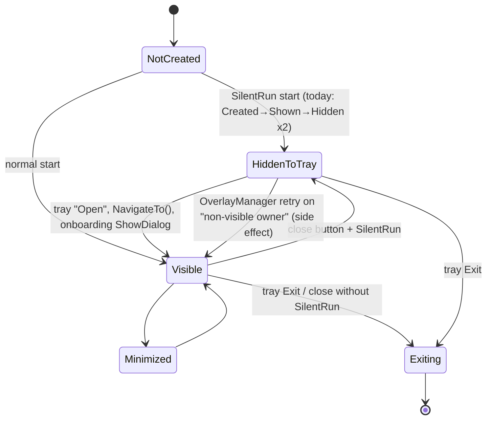
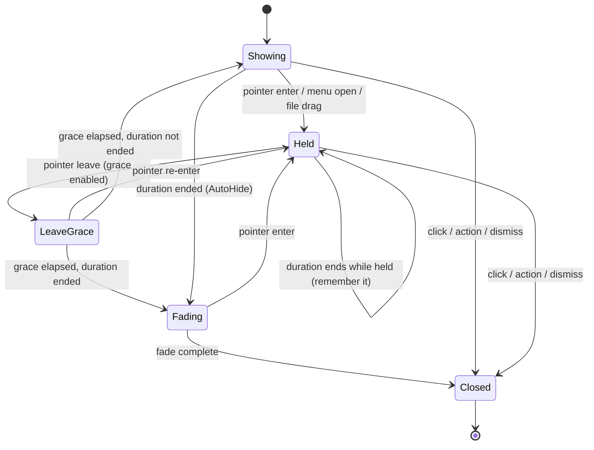

# XIP0091 Lightweight Tray-Resident UI

**Status**: Draft (analysis complete; no code changed)

**Created**: 2026-11-13  
**Updated**: 2026-11-13  
**Area**: Desktop | UI | Core | Platform | Performance  
**Goal**: Make XerahS cheaper to keep running and simpler to use, measured by numbers that anyone can reproduce: tray-only startup and idle memory, hotkey-to-overlay latency, and clicks per common task.  
**Related**: [XIP0017 Screen Recording Modernization](XIP0017-screen-recording-modernization.md), [XIP0018 Component Wiring Diagram](XIP0018-component-wiring-diagram.md), [IEIP0006 Wallpaper prewarm](../ieip/IEIP0006-move-wallpaper-prewarm-to-imageeditor.md)  
**Publication**: Local draft; no GitHub issue created. Reconcile the provisional number before publication.

---

## How this draft was produced, and its limits

This is a static analysis of `develop` at `d3f0016` (2026-11-13). The analysis environment could not reach NuGet or the .NET SDK download, so **nothing here was built, run or measured**. Every runtime claim below is a hypothesis with a named measurement. `scripts/perf/Measure-UiWeight.ps1` is the measurement. Run it before accepting or rejecting any item.

## 1. What "lightweight" means here

There are two different weights. Every change below says which one it targets.

| Weight | Metric | Source |
|---|---|---|
| **A. Runtime** | Startup time; async init time | `Program.cs` already logs `Startup time: N ms (+ M ms async init)` |
| | Private memory and working set at 5 s, 30 s, 2 min and 10 min after a tray-only start | Process sampling (script) |
| | Hotkey → overlay visible | `OverlayManager` already logs `[RegionCapture] Milestone: overlay displayed (+N ms)` |
| | Thread and handle count at idle | Process sampling (script) |
| **B. Perceived** | Windows, pages and clicks to finish the top tasks | Manual click-count protocol (§7) |

The design target is the **tray-only user**: someone who never opens the main window and only uses hotkeys. XerahS spends almost all of its life in that state. Right now that user pays for UI they never see.

## 2. What a tray-only start costs today

This is the order of work on start-up with SilentRun on:

1. `Program.cs:705–806` starts a background task. It loads **every uploader plugin** (`ProviderCatalog.LoadPlugins`, line 735) and initializes the **recording platform**, whether or not the user ever uploads or records.
2. `App.OnFrameworkInitializationCompleted` builds the full image-editor `MainViewModel` (`App.axaml.cs:171`). It also decodes `Sample.png` into an `SKBitmap` so the annotation toolbar is ready (lines 176–211).
3. It constructs `MainWindow` (line 255). Its constructor calls `NavigateTo("Editor")` (`MainWindow.axaml.cs:126`), which builds the full `EditorView`.
4. The lifetime **shows** the window and then hides it again. Two hides are needed, because `Show()` can finish after `Opened` (lines 277–305).
5. `OnWindowOpened` fires because the window was shown. That pre-warms the settings search index (`MainWindow.axaml.cs:517–519`), which **builds `ApplicationSettingsView` and `DestinationSettingsView`** and initializes every destination view model (`PreWarmSettingsSearchIndexAsync`, line 558).
6. `IdleMemoryTrimmer` (`Services/IdleMemoryTrimmer.cs`) runs 20 s later. It does two blocking, aggressive, compacting gen-2 GCs plus native heap and working-set trims, to hand back the memory steps 2–5 just allocated.

So the app builds four large UI trees it does not show, then works to give back the memory. Step 6 treats the symptom of steps 2–5. Trimming the working set also has a hidden cost: the next hotkey press has to page Avalonia, Skia and editor code back in. That shows up as hotkey latency, and the script measures it.

## 3. Deep modules and interfaces

The "deep module" test (Ousterhout): a module is deep when its interface is small compared with what it hides. These are the shallow or leaky spots that make the UI heavier to change and to run.

### 3.1 Three ways of wiring services into one app
- A DI container: `Services/CompositionRoot.cs`.
- A static service locator: `PlatformServices`, with 40 public static members. Callers check `PlatformServices.IsInitialized`, `IsToastServiceInitialized` and `IsThemeServiceInitialized` because the order things get initialized in is visible to them.
- Static `Instance` singletons: `TrayIconHelper`, `UpdateService`, `SettingsSearchService`, `UploadQueueService`, `TaskManager`, `ScreenRecordingManager`, `WatchFolderManager`, `InstanceManager`.
- Static mutable callbacks that Core uses to reach up into the UI. `WorkerTask` has six (`ShowWindowSelectorCallback`, `OpenMainWindowCallback`, `ExitApplicationCallback`, …) and Core has 12 in total.

**Proposal:** one `IDesktopShell` interface that Core depends on. It replaces the 12 static callbacks with a single narrow contract: select a window, pick a file, open the main window, open history, exit, toggle hotkeys. `PlatformServices` keeps its static API for plugin compatibility. Initialization moves to one place, before any consumer runs, so the `IsInitialized` checks can be deleted one by one.

### 3.2 Navigation driven by strings
`MainWindow.Navigation.cs` sends string tags (`"Settings_Dest"`, `"Upload_FileUpload"`, …) through `NavigateTo`, `InvokeNavigationNode`, `HandleNavigationTag` and `ToolNavigationHelper.TryHandleToolsTag`. Some tags create pages and others start workflows. Some pages are cached (Editor, both Settings views) and others are rebuilt on every visit.

**Proposal:** a typed route table, one deep `Navigator.Go(Route)`, where each route declares three things: page or action, cached or transient, and whether it needs the main window to be visible. That replaces four code paths with one, and makes "do not create this until it is shown" a property of the route instead of a coincidence.

### 3.3 A search index built by instantiating views
The settings search index is built by creating the real settings views and walking them. That is why a tray-only start builds both settings pages. It has already caused one state bug: the pre-warmed `SettingsViewModel` kept a stale theme and auto-saved it back after onboarding. That needed a manual sync patch (`MainWindow.axaml.cs:532–538`).

**Proposal:** build the index from metadata, either a source generator or a one-time reflection scan of settings attributes, with no views created. If that is too big a change, build it lazily on the first keystroke in the search box.

### 3.4 One setting, three behaviors
`SettingsManager.Settings.SilentRun` decides all of these:
- starting hidden (`App.axaml.cs:244`)
- whether closing the window hides it to the tray (`MainWindow.axaml.cs:594`)
- macOS menu-bar-only mode and taskbar visibility (`ApplyMenuBarOnlyModeFromSettings`)

As a result, a user who wants close-to-tray but a visible start cannot have it.

**Needs a maintainer decision.** Splitting it into `StartHidden` and `CloseToTray` changes the settings schema and needs a migration.

## 4. Implicit state machines

Two machines are already explicit: `TaskStatusMachine` and `RecordingStateMachine`. Both only log illegal transitions; they don't block them. The rest live in bool flags, timers and calls spread across many files.

### 4.1 Main window presence (implicit; 11 files touch it)
Show, Hide, Activate, `ShowInTaskbar` and `WindowState` are changed from `App.axaml.cs`, `MainWindow.axaml.cs`, `MainWindow.Navigation.cs`, `TrayIconHelper.cs`, `WorkflowOrchestrator.cs`, `AvaloniaLifecycleService.cs`, `ModalDialogHost.cs`, `UploadContentToolService.cs`, `SilentRunStartupPolicy.cs`, `RegionCapture/Services/OverlayManager.cs` and `Program.cs`.



Risks found:
- **The overlay retry can leave the main window visible.** `OverlayManager.EnsureMainWindowVisibleForOverlayRetry` shows and restores the main window when `Show()` fails with "non-visible owner". Nothing hides it again afterwards. A tray-only user on a setup that hits this path (the comments point to X11) would see the main window pop up during a capture. **Needs a reproduction on X11.**
- **Start-up shows the window and then hides it twice.** The extra hide exists because Avalonia sometimes finishes `Show()` after `Opened`. Not creating the window until it is needed (§6, PR 4) removes the race completely.
- **Onboarding is skipped when SilentRun hid the window** (`!_silentRunHideApplied`). A first-run user with an imported SilentRun config never sees onboarding. Check whether that is intended.

**Proposal:** one `MainWindowPresence` owner with the states above, the only code allowed to show or hide the window. Everyone else asks it.

### 4.2 Toast lifecycle (implicit: 4 timers × 5 bools)
`ToastViewModel` (1,006 lines) holds `_durationTimer`, `_fadeTimer`, `_leaveGraceTimer` and `_deferredCloseTimer`, plus `_isDurationEnd`, `_isMouseInside`, `_isHovered`, `_isMenuOpen` and `_isFileDragActive`. That is up to 2⁵ flag combinations multiplied by the timer states. A fixed bug is already documented in the code: closing the context menu before `_isDurationEnd` was set left the toast stuck (comment at lines 453–456).



**Proposal:** one `ToastPhase` enum plus a `DurationElapsed` flag, with a `Transition(ToastEvent)` method and a table test for every (phase, event) pair. That deletes four of the five bools, and the bug class in the line-453 comment can't happen any more.

### 4.3 Recording: one explicit machine, mirrored three times
`RecordingStateMachine` already defines `RecordingUiState.From(status, supportsPauseResume)` as "single source of truth for the status text and button availability". Even so:
- `RecordingViewModel` keeps six parallel bools: `_isRecording`, `_isPaused`, `_canStart`, `_canStop`, `_canPauseResume` and `_canAbort`.
- `TrayIconHelper` works out icon, tooltip, `IsRecordingActive`, `canStop` and pause/resume again from the raw `RecordingStatus` (lines 110–170 and 573–574).
- Each platform recorder keeps its own copy of `RecordingStatus`: WGC/native on Windows, macOS, Wayland portal, FFmpeg and `ScreenRecorderService`.

**Proposal:**
- Expose `RecordingUiState` as the one property both `RecordingViewModel` and `TrayIconHelper` bind to, and delete the mirrors.
- Once logs show no `unexpected recording transition` lines across the CI recording verifiers (`xerahscli verify-recording` and `verify-gif-recording`), make `Observe` reject illegal transitions instead of only logging them.
- Apply the same promotion to `TaskStatusMachine`.

### 4.4 Other machines to make explicit (lower priority)

| Machine | Where the state lives today | Unhandled situations to test |
|---|---|---|
| Region capture session | `CaptureState` enum plus 8 bools in `OverlayWindow` (`_isDrawing`, `_rebuildPending`, `_selectionInteractionActive`, `_windowClosed`, …) | monitor unplugged or DPI changed mid-selection; a second hotkey press during selection; focus stolen on Wayland |
| Platform service lifecycle | `PlatformServices.IsInitialized` checked in many files | a hotkey firing before init completes; CLI or daemon paths that never initialize the UI service |
| Clipboard monitor | `IsMonitoring`, plus suppression while XerahS writes the clipboard | toggling the setting during a capture; Linux without a main window (see §5) |
| Idle memory trimmer | timer, `_trimRunning`, `_lastTrimUtc` | a trim starting just before a hotkey press, so the GC pause adds to overlay latency |
| First run / onboarding | `IsFirstTimeRun`, `_onboardingShown`, `_silentRunHideApplied` | SilentRun on first run; the app quitting during the wizard |
| Settings page pre-warm | `_applicationSettingsView ??=` plus manual theme sync | any setting changed outside the page while a pre-warmed view model is alive |

## 5. Scenarios every change must survive

| Scenario | Why it matters for laziness |
|---|---|
| Linux/macOS clipboard | On non-Windows, `AvaloniaClipboardService` is built from `MainWindow.Clipboard` (`App.axaml.cs:268`). Creating the window lazily needs another host for the clipboard. **Check whether Avalonia 12.1 offers a clipboard not tied to a TopLevel**; if it doesn't, keep a tiny hidden host or create `MainWindow` without the editor. |
| X11 owner rules | Overlays clear their owner and retry when the owner isn't visible (§4.1). |
| Wayland (portal hotkeys/recording), Flatpak (DBus tray denial, issue #270) | Startup must still survive a tray icon that fails. |
| macOS menu-bar-only mode | Tied to SilentRun today (§3.4). |
| Multi-monitor and mixed DPI; monitor hot-plug while in the tray | Overlays are rebuilt for each capture, one per monitor. |
| First run vs. a power user with large history and many plugins | Destination pre-warm work grows with the number of providers. |
| Offline; plugin folder missing or broken | Loading plugins lazily moves those errors to first use, so they need to show up in the UI then. |
| Keyboard-only and screen-reader users | Typed routes must keep the current access keys and focus order. |
| A user who opens the main window often | Lazy creation must not add noticeable first-open delay. Show a placeholder and build the editor on idle once the window is visible. |

## 6. Ranked changes (each sized as one PR)

| # | Change | Weight | Expected effect (to be measured) | Risk | Main files |
|---|---|---|---|---|---|
| 1 | Don't build `EditorView` or decode `Sample.png` until the Editor page is first shown | A | Less tray-only memory and startup work | Low; check any code that assumes `_editorView` exists | `MainWindow.axaml.cs:126`, `App.axaml.cs:176–211`, `MainWindow.Navigation.cs` |
| 2 | Defer the settings search pre-warm until the main window is actually visible, or until the first search keystroke | A | Two settings trees and all destination view models no longer built at tray start | Low; first settings search may be slower | `MainWindow.axaml.cs:517–584` |
| 3 | Single `RecordingUiState` property; delete the mirrors in `RecordingViewModel` and `TrayIconHelper` | Simpler code | Fewer chances for UI and tray to disagree | Low; covered by `TrayIconMenuTests` | `RecordingViewModel.cs`, `TrayIconHelper.cs` |
| 4 | Create `MainWindow` only when it is first needed, behind a `MainWindowPresence` owner | A + simpler code | Removes the show-then-hide race and the window surface | **Medium**; needs the clipboard host decision (§5) | `App.axaml.cs`, `SilentRunStartupPolicy.cs` and the other 10 files that show or hide the window |
| 5 | Explicit `ToastPhase` machine with a table test | Simpler code | Removes a known bug class | Low–medium | `ToastViewModel.cs` |
| 6 | Read plugin manifests at startup; load plugin assemblies when a destination is first used | A | Less startup memory; size depends on the plugins | Medium; errors move to first use | `ProviderCatalog`, `Program.cs:734–735` |
| 7 | Initialize recording platform services lazily (first recording, or after the app has been idle for some seconds) | A | Less async init work | Medium; first-record latency | `Program.cs:705–806`, `ScreenRecordingManager` |
| 8 | Measure working-set trimming against hotkey latency; keep it only if the latency cost is acceptable | A | Faster first hotkey press after idle | Low | `IdleMemoryTrimmer.cs` |
| 9 | Typed route table and a single `Navigator.Go(Route)` | Simpler code / B | One navigation path; laziness per route | Medium | `MainWindow.Navigation.cs`, `ToolNavigationHelper` |
| 10 | `IDesktopShell` replaces the 12 static Core→UI callbacks | Simpler code | Testable Core; no init-order traps | Medium | `WorkerTask.cs`, `CaptureJobProcessor.cs`, `WorkflowManager.cs` |
| 11 | Enforce transitions in `RecordingStateMachine` and `TaskStatusMachine` | Correctness | Illegal states rejected, not just logged | Medium; do it only after a clean log period | `RecordingStateMachine.cs`, `TaskStatusMachine.cs` |
| 12 | Split SilentRun into `StartHidden` and `CloseToTray` | B | Fewer surprises | Needs maintainer decision and a settings migration | `ApplicationConfig.cs`, settings UI |

Order: do 1, 2 and 8 first. They are small, easy to undo, and the most likely to move the tray-only numbers. Then 3 and 5 (state cleanup with tests), then 4, 6 and 7 once the baseline shows how much they are worth.

## 7. Verification

**Runtime (A):** publish the build before and after each change, then run

```
pwsh scripts/perf/Measure-UiWeight.ps1 -AppDir <publish dir> -Label <before|after> -Runs 5 -CaptureSamples 5
pwsh scripts/perf/Measure-UiWeight.ps1 -Compare
```

- Compare medians over at least 5 runs, on at least Windows and one Linux session type (X11 or Wayland). Report the spread, not only the median.
- A change "works" only if its target metric moves by more than the run-to-run spread and no other metric regresses by more than 5%.
- Proposed CI gate once there is a baseline: fail when tray-only private memory at 2 min, or median overlay latency, regresses by more than 10%. Track it per OS, because the numbers are not comparable across OSes.

**Behavior:** for each state machine change, add a table test covering every (state, event) pair: Toast, MainWindowPresence, and RecordingUiState mapping. These must pass:
- `XerahS.Tests` (including `SilentRunStartupPolicyTests`, `TrayIconMenuTests`)
- `XerahS.Audits.Tool`
- `xerahscli verify-region-capture`, `verify-recording` and `verify-gif-recording`

**Perceived weight (B):** count clicks from the tray, before and after, for:
- capture region and upload
- record and stop
- pin a capture to the screen
- OCR
- find yesterday's upload in history
- change the default destination
- open the editor on the last capture
- run a workflow

**Final judge:** ShareX maintainers' review against `CONTRIBUTING.md`.

## 8. Open questions for maintainers

1. Is it acceptable for the first main-window open to be slower in exchange for a lighter tray? (Affects PRs 1, 2 and 4.)
2. Can plugin load failures move from startup to first use? (PR 6)
3. Can the SilentRun setting be split? (PR 12)
4. Does Avalonia 12.1 offer a clipboard that isn't tied to a window? (Blocks PR 4 on Linux and macOS.)
